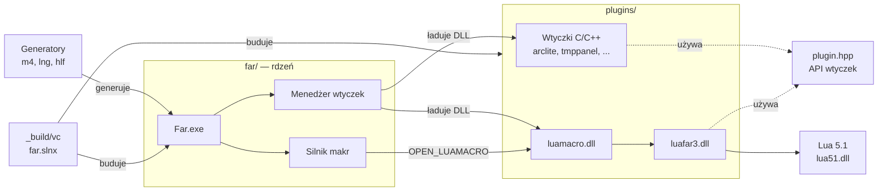
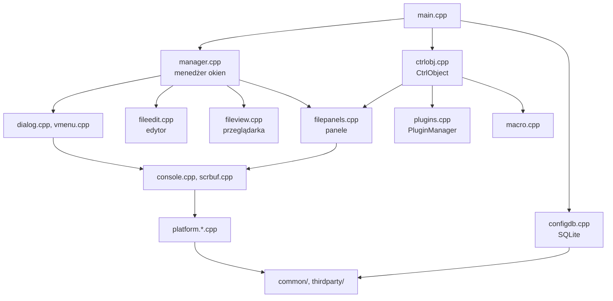
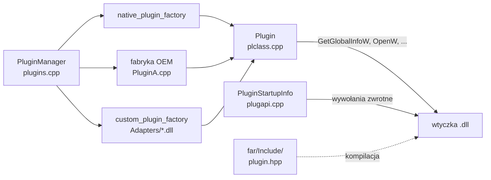
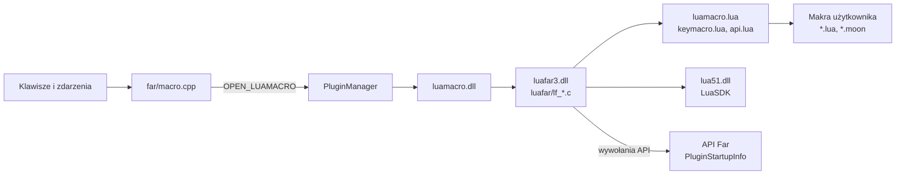
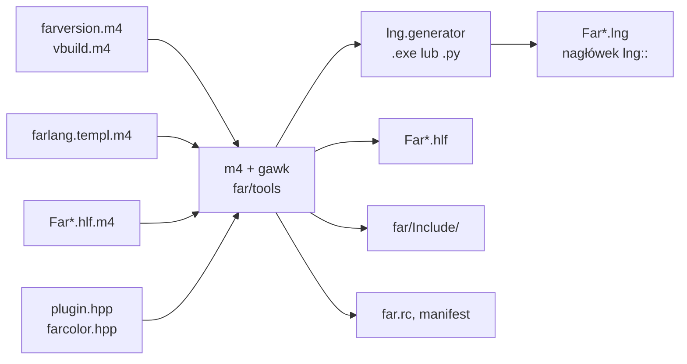
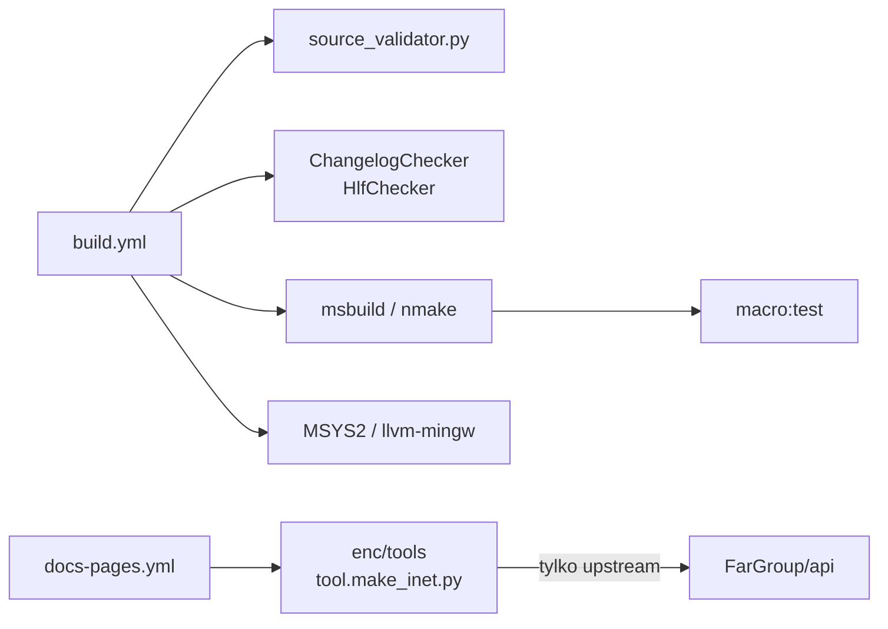

# Architektura Far Managera

Dokument opisuje strukturę repozytorium i zależności między głównymi częściami: rdzeniem (`far/`), API wtyczek i wtyczkami (`plugins/`, w tym LuaMacro/LuaFAR) oraz elementami pomocniczymi (`enc/`, `misc/`, `_build/`). Opis bazuje na kodzie i plikach budowania z gałęzi `master`. Szczegóły budowania są w sekcji „Budowanie” pliku [README-PL.md](../README-PL.md#budowanie).

## Spis treści

1. [Przegląd](#przegląd)
2. [Rdzeń (`far/`)](#rdzeń-far)
3. [API wtyczek i ładowanie wtyczek](#api-wtyczek-i-ładowanie-wtyczek)
4. [LuaMacro i LuaFAR](#luamacro-i-luafar)
5. [Generowane pliki: wersja, języki, pomoc, nagłówki](#generowane-pliki-wersja-języki-pomoc-nagłówki)
6. [Dokumentacja, CI i narzędzia pomocnicze](#dokumentacja-ci-i-narzędzia-pomocnicze)
7. [Mapa katalogów](#mapa-katalogów)

## Przegląd

Far Manager to aplikacja konsolowa (`Far.exe`) napisana w C++. Rdzeń obsługuje panele, edytor, przeglądarkę, okna dialogowe i konfigurację. Większość dodatkowych funkcji (archiwa, sieć, porównywanie, makra) dostarczają wtyczki DLL, które komunikują się z rdzeniem przez publiczne API z `plugin.hpp`. Makra wykonuje wtyczka LuaMacro zbudowana na bibliotece LuaFAR.

## Rdzeń (`far/`)

Katalog `far/` zawiera ok. 400 plików, z których powstaje jeden plik wykonywalny. Najważniejsze grupy:

| Warstwa | Przykładowe pliki | Rola |
|-|-|-|
| Start i stan globalny | `main.cpp`, `global.cpp`, `ctrlobj.cpp` | punkt wejścia, obiekty globalne (`Global->CtrlObject` z panelami, wtyczkami i makrami, `Global->WindowManager`) |
| Menedżer okien | `manager.cpp`, `window.cpp`, `desktop.cpp` | kolejka okien, przełączanie, modalność |
| Panele | `filepanels.cpp`, `panel.cpp`, `filelist.cpp`, `treelist.cpp`, `infolist.cpp`, `qview.cpp` | panele plików, drzewa, informacji i szybkiego podglądu |
| Edytor i przeglądarka | `fileedit.cpp`, `editor.cpp`, `fileview.cpp`, `viewer.cpp` | edycja i podgląd plików |
| Interfejs | `dialog.cpp`, `vmenu.cpp`, `cmdline.cpp`, `help.cpp` | okna dialogowe, menu, wiersz poleceń, pomoc `.hlf` |
| Operacje na plikach | `copy.cpp`, `delete.cpp`, `execute.cpp` | kopiowanie, usuwanie, uruchamianie programów |
| Wtyczki i makra | `plugins.cpp`, `plclass.cpp`, `plugapi.cpp`, `PluginA.cpp`, `macro.cpp` | ładowanie wtyczek, implementacja API, most do LuaMacro |
| Konfiguracja | `config.cpp`, `configdb.cpp`, `sqlitedb.cpp` | opcje i ich zapis w bazach SQLite |
| Konsola | `console.cpp`, `scrbuf.cpp`, `interf.cpp`, `keyboard.cpp` | rysowanie ekranu, bufor, wejście z klawiatury |
| Warstwa systemowa | `platform.*.cpp`, `platform.sdk/` | opakowania Win32 (pliki, procesy, rejestr, COM) |
| Biblioteki wspólne | `common/` | narzędzia C++ niezależne od Far (łańcuchy, zakresy, `uuid`) |
| Biblioteki zewnętrzne | `thirdparty/` | `sqlite`, `fmt`, `tinyxml2`, `uchardet`, `catch2` |

Diagram pokazuje uproszczone zależności warstw, a nie pełny graf wywołań. Rdzeń zawiera też testy jednostkowe (`*.tests.cpp`, Catch2) włączane zmienną `ENABLE_TESTS` (w makefile'ach domyślnie `1`) oraz projekt `common_test.vcxproj`.

## API wtyczek i ładowanie wtyczek

Publiczne API to nagłówki `far/plugin.hpp` i `far/farcolor.hpp` oraz ich odpowiedniki dla Pascala (`PluginW.pas`, `FarColorW.pas`). Podczas budowania m4 (`headers.m4`, `scripts/plugins.awk`) wstawia do nich dane wersji i zapisuje je w `far/Include/`, skąd korzystają z nich wtyczki. Wtyczka eksportuje funkcje takie jak `GetGlobalInfoW`, `SetStartupInfoW` i `OpenW`. Rdzeń przekazuje jej strukturę `PluginStartupInfo` ze wskaźnikami do funkcji zaimplementowanych w `plugapi.cpp`.

`PluginManager::LoadFactories()` w `plugins.cpp` rejestruje fabryki modułów:

* `native_plugin_factory` — natywne wtyczki Unicode (Far 3);
* fabryka OEM z `PluginA.cpp` — stare wtyczki ANSI (Far 1.x), gdy włączona jest opcja `OEMPluginsSupport`, a kod zbudowano bez `NO_WRAPPER`;
* `custom_plugin_factory` — adaptery `*.dll` z katalogu `Adapters`, które pozwalają ładować wtyczki w innych modelach.

### Wtyczki w `plugins/`

Wspólna infrastruktura jest w `plugins/common/` (m.in. `vc_crt_fix` dla zgodności ze starszymi wersjami Windows) i w plikach `plugins/makefile_*`. `makefile_all_vc` domyślnie buduje:

| Wtyczka | Funkcja |
|-|-|
| `arclite` | obsługa archiwów (7-Zip) |
| `tmppanel` | panel tymczasowy |
| `network` | przeglądarka sieci |
| `proclist` | lista procesów |
| `compare` | porównywanie paneli |
| `hlfviewer` | podgląd plików pomocy `.hlf` |
| `farcmds`, `emenu`, `samefolder`, `filecase` | dodatkowe polecenia, menu kontekstowe Eksploratora, ten sam folder w drugim panelu, wielkość liter w nazwach plików |
| `align`, `autowrap`, `brackets`, `drawline`, `editcase` | rozszerzenia edytora |
| `luamacro` | makra w Lua (opis niżej) |

Katalogi `multiarc` i `ftp` są w repozytorium, ale w `makefile_all_vc` są zakomentowane; `multiarc` jest za to w `_build/vc/far.slnx`. `helloworld` to przykładowa wtyczka, a `newarc`, `newarc.ex` i `macroview` nie są budowane domyślnie.

## LuaMacro i LuaFAR

System makr ma dwie warstwy:

* `far/macro.cpp` w rdzeniu obsługuje klawisze i zdarzenia, ale nie interpretuje makr. Przekazuje je wtyczce LuaMacro przez `CallPlugin(...Luamacro.Id, OPEN_LUAMACRO, ...)`.
* `plugins/luamacro/` zawiera wtyczkę `luamacro.dll` i bibliotekę `luafar3.dll` (`luafar/lf_*.c`), która udostępnia w Lua API Far (panele, edytor, dialogi, wyrażenia regularne, UTF-8). Logika makr jest napisana w Lua: `luamacro.lua`, `keymacro.lua`, `api.lua`, `panelsort.lua` i `mbrowser.lua`. `macrotest.lua` to zestaw testów uruchamiany poleceniem `Far.exe -service "macro:test"`.

Biblioteka Lua 5.1 (`lua51.dll`) pochodzi z archiwum LuaSDK, które budowanie pobiera z FarGroup/thirdparty. W repozytorium są tylko nagłówki (`luasdk/include`). `luafar/lfjit` buduje interpreter `lfjit.exe` korzystający z `lua51.dll` i `luafar3.dll`.

Pliki `lm_*.lng` zawierają komunikaty wtyczki w kilku językach, a `moonscript.lua` pozwala pisać makra i moduły w MoonScript (`*.moon`).

## Generowane pliki: wersja, języki, pomoc, nagłówki

Wielu plików rdzenia nie edytuje się bezpośrednio. Powstają podczas budowania za pomocą narzędzi z `far/tools/` (`m4.exe`, `gawk.exe`, `lng.generator.exe`) albo ich systemowych odpowiedników:

* **Wersja** — `farversion.m4` i `vbuild.m4` (numer builda) zasilają `farversion.inc.m4`, `far.rc.inc.m4`, `Far.exe.manifest.m4` i `File_id.diz.m4`.
* **Języki** — wszystkie komunikaty są w `farlang.templ.m4`. m4 tworzy z niego `farlang.templ`, a generator (`tools\lng.generator.exe` albo `misc/lng/lng.generator.py` przy `PYTHON=1`) tworzy pliki `Far*.lng` i nagłówek z identyfikatorami komunikatów (`lng::M...`). Źródła C++ generatora i narzędzi pokrewnych są w `misc/lng/`.
* **Pomoc** — m4 i `scripts/mkhlf.awk` zamieniają `Far*.hlf.m4` (np. `FarEng.hlf.m4`, `FarPol.hlf.m4`) na pliki `.hlf`.
* **Nagłówki API** — `plugin.hpp`, `farcolor.hpp` i pliki `.pas` trafiają do `far/Include/` z podstawionymi danymi wersji (`headers.m4`, `scripts/plugins.awk`).

## Dokumentacja, CI i narzędzia pomocnicze

* **`enc/`** — Encyklopedia Far Managera, czyli dokumentacja API wtyczek i makr: `enc_eng`, `enc_rus` i `enc_lua` (podręczniki LuaFAR i Macro API). Narzędzia w `enc/tools` budują wersję CHM (`tool.make_enc_chm.bat`, `tool.make_lua_chm.bat`) i wersję WWW (`tool.make_inet.py`). Workflow `docs-pages.yml` publikuje wersję WWW w FarGroup/api (strona api.farmanager.com), ale tylko w repozytorium upstream.
* **`misc/build-checks/`** — walidatory .NET uruchamiane w CI: `ChangelogChecker` (format pliku `changelog`) i `HlfChecker` (spójność plików pomocy).
* **`misc/lng/`** — generator plików językowych (Python i C++) oraz narzędzia do wstawiania i konwersji komunikatów.
* **`misc/nightly/`** — skrypty nocnych buildów i pakietów; **`misc/msi-installer/`** — instalator MSI; **`misc/fexcept/`**, **`misc/artwork/`** i **`misc/changelog/`** — dodatki, grafika oraz makro do nagłówków changeloga.
* **`far/tools/source_validator.py`** — kontrola stylu kodu źródłowego (job `code-style-checks` w CI).
* **`_build/vc/`** — rozwiązanie Visual Studio `far.slnx` (rdzeń, SQLite, testy i wtyczki) oraz wspólne ustawienia MSBuild i nmake w `_build/vc/config/` (`common.props`, `common.mak`).

## Mapa katalogów

| Katalog | Zawartość |
|-|-|
| `far/` | rdzeń `Far.exe`, nagłówki API, szablony m4, pliki pomocy i języków, `tools/` |
| `plugins/` | wtyczki standardowej dystrybucji i wspólne makefile'e |
| `plugins/luamacro/` | LuaMacro, LuaFAR (`luafar/`), nagłówki Lua (`luasdk/`) |
| `_build/vc/` | rozwiązanie Visual Studio i konfiguracja budowania |
| `enc/` | Encyklopedia (dokumentacja API i makr) |
| `misc/` | walidatory CI, generator `lng`, instalator, skrypty nightly |
| `extra/` | dodatki dystrybucji (`Addons`, `Documentation`, `VisualElements`) |
| `docs/` | dokumentacja specyficzna dla tego forka |
| `.github/` | workflow CI, Dependabot, szablony zgłoszeń |
